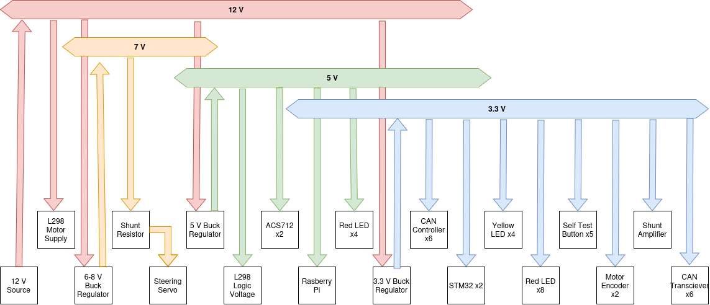

| Power Rail | Contributing Factors | Peak Current| Avg Current | Worst-Case Voltage |
| -------- | -------- | -------- | -------- | -------- |
| 3.3 Volts | STM32 (36.3 mA max, 31.1 mA typical) x 2, CAN Controller (10 mA max, 10 mA typ) x 6,  CAN Transciever (17 mA max, 10 mA typ) x 6, Yellow LED (10.8 mA max, 0 typ) x 4, Red LED (9.2 mA Max, 0 typ) x 8, self test button (0.33 mA max, 0 typ) x 5, INA180 (260 uA max, 197 uA typ), Motor Encoded (estimated 25 mA max, typ) x2 | 403.31 mA | 232.34 mA | TBD |
| 5 Volts | L298 Logic (36 mA max, 24 typ), ACS712 (13 mA max, 10 mA typ) x2, Rasberry Pi (3 A max, 1 A typ), RED LED (22.3 mA max, 0 typ) x4 | 3.151 A | 1.044 A | - |
| 7 Volts | Steering Servo (3 A max, 100 mA typ) | 3 A | 0.1 A | - |
| 12 Volts | Motor (3.2 A max, 0.36 typ) x 2, 3V3 Buck Converter (100 mA max, 55 mA typ), 5V Buck Converter (1.35 A max, 0.457 A typ), 7 V Buck Converter (1.94 A max, 65 mA typ) | 9.79 A | 1.297 A | 9.063 |

Notes:
Yellow LED current calculated as (3.3 V - 2 V) / 120 ohms = 10.8 mA

Red LED current for STM32s calculated as (3.3 V - 2.2 V ) / 120 ohms = 9.2 mA

Button current calculated as 3.3 V / 10k ohms = 0.33 mA

For the buck regulators, input current given by I_in = (Vout * Iout) / (efficiency * Vin)
90% efficiency estimated for 7V regulator, since no chart on the data sheet

Estimating 30 mOhm internal resistance for NiMH batteries, max voltage drop is 9.79 A * 10 batteries * 30 mOhm / battery = 2.937 Volts

## NOTES and TODO

- X5R ceramics like the ones we're using on buck inputs lose capacitance under DC bias, so we need to have more than 2 on the 5V and 7V rails to maintain the same effective capacitance (Claude estimates 40% loss on the 7V line, 25% on the 5V)
- 7 V rail is now 6.8 Volts
- Need to take another look at jumpers
- Add protection circuit
- Confirm SWD working correctly
- Determine 12 V rail power source
- Recompute current draw
- Somebody needs to take a look at what I did for power sourcing on the STM32s (all the VDD, AVDD, VCAP, etc.) and what I did for Boot0 (pull down resistor)
- I added buttons so that we can reset the STM32s ourself, not in spec, I just thought it'd be useful
- Need to figure out where to add termination resistiors on layout
- Figure out how to change silkscreen labels on connectors so that it's easy to write things on the board
