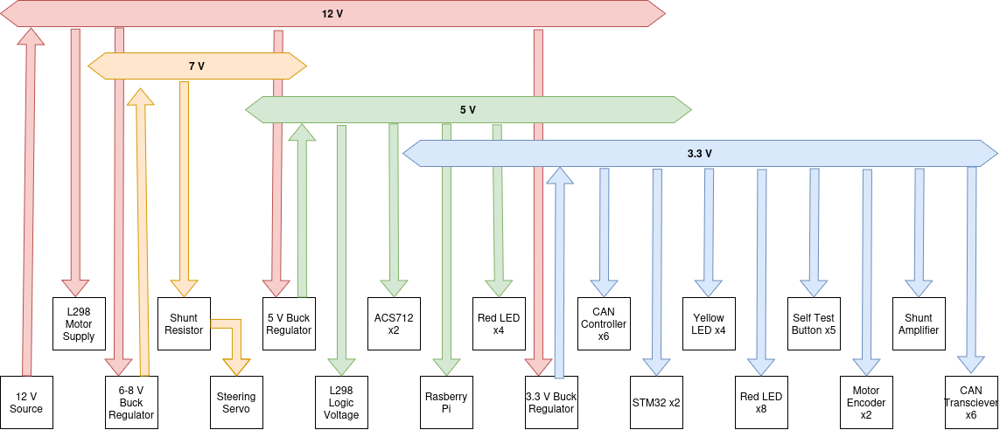
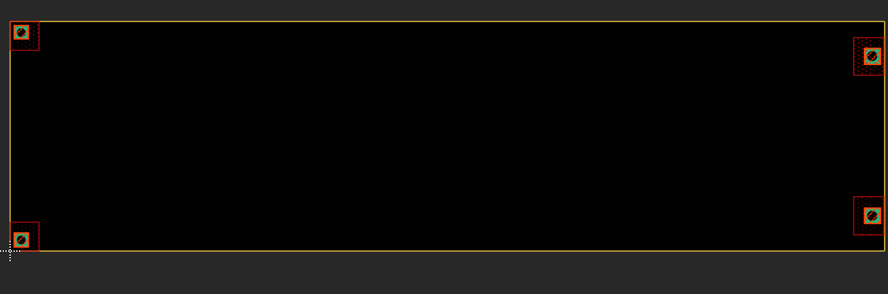
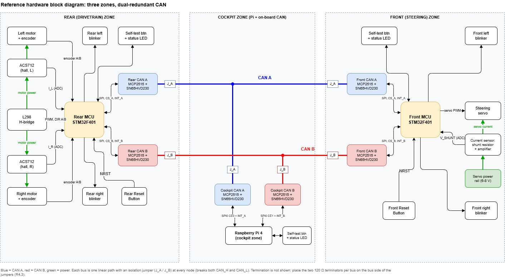
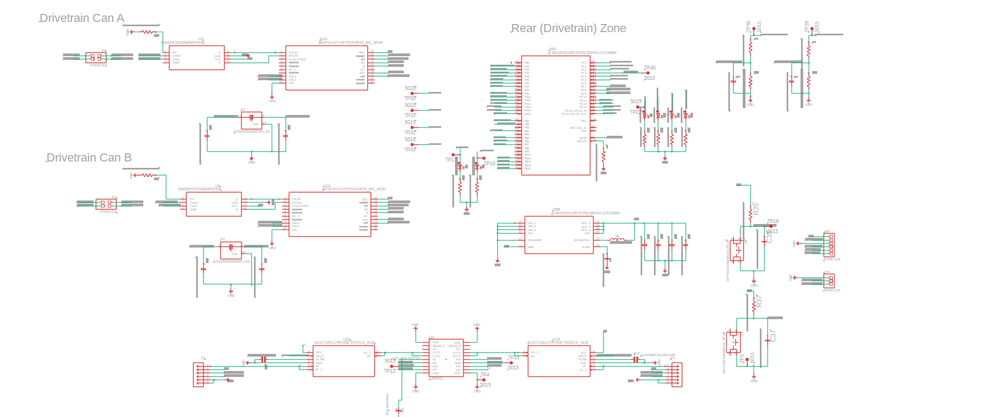
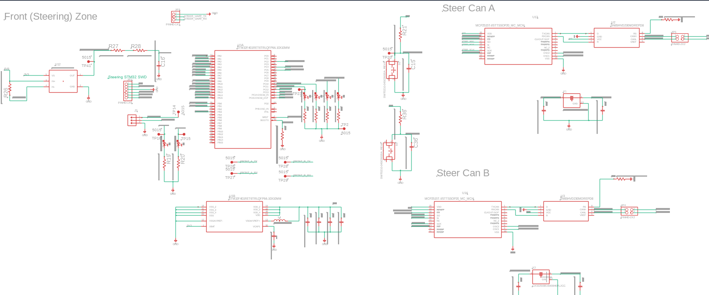
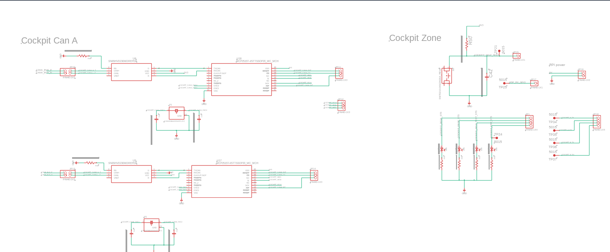
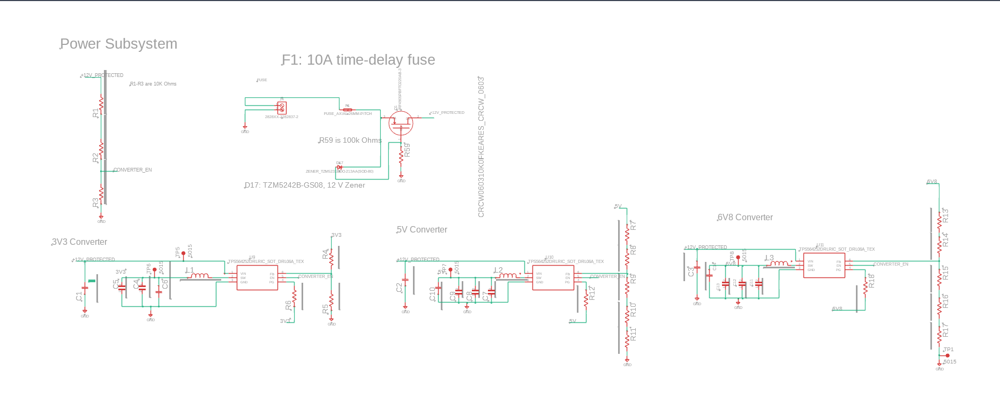
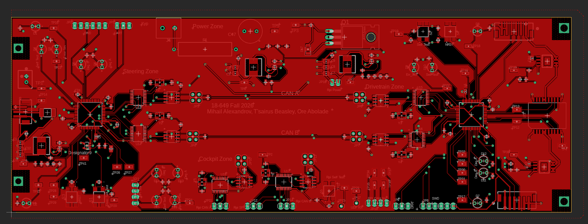
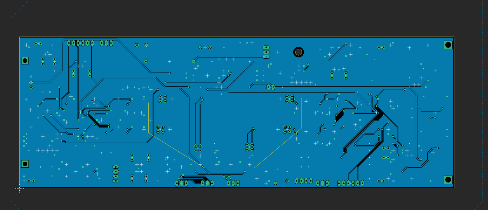
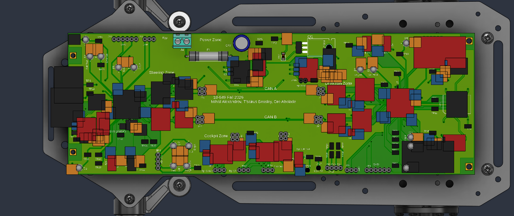

# 1.1 Power Source And Ratings

| Power Rail | Contributing Factors | Peak Current| Avg Current | Worst-Case Voltage |
| -------- | -------- | -------- | -------- | -------- |
| 3.3 Volts | STM32 (36.3 mA max, 31.1 mA typical) x 2, CAN Controller (10 mA max, 10 mA typ) x 6,  CAN Transciever (17 mA max, 10 mA typ) x 6, Yellow LED (10.8 mA max, 0 typ) x 4, Red LED (9.2 mA Max, 0 typ) x 8, self test button (0.33 mA max, 0 typ) x 5, INA180 (260 uA max, 197 uA typ), Motor Encoded (estimated 25 mA max, typ) x2 | 403.31 mA | 232.34 mA | 3.3 V |
| 5 Volts | L298 Logic (36 mA max, 24 typ), ACS712 (13 mA max, 10 mA typ) x2, Rasberry Pi (3 A max, 1 A typ), RED LED (22.3 mA max, 0 typ) x4 | 3.151 A | 1.044 A | 5 V |
| 6.8 Volts | Steering Servo (3 A max, 100 mA typ) | 3 A | 0.1 A | 6.8 V |
| 12 Volts | Motor (3.2 A max, 0.36 typ) x 2, 3V3 Buck Converter (120.6 mA max, 71.0 mA typ), 5V Buck Converter (1.382 A max, 0.472 A typ), 6V8 V Buck Converter (1.89 A max, 64.3 mA typ) | 9.79 A | 1.327 A | 7.105 V |

**Sources:** every current and voltage in this table is taken from the part
datasheets, except the motor encoder current, which is an estimate. None were
measured on hardware yet.

**Selected battery source:** Tenergy **11616**, a 10S1P Sub-C NiMH battery
pack: 12 V nominal, 4.2 Ah (50.4 Wh), 30 A maximum continuous discharge,
113 x 91 x 23 mm, 1.55 lb, with a Standard Tamiya connector.  The 30 A
rating provides margin over the calculated 9.79 A peak system load.  It is an
off-board part, but is included in the project BOM.  The board-side power
input connector must mate with its Standard Tamiya connector (or use a
documented Tamiya-to-board harness); do not select an XT60 footprint unless
the battery harness is changed accordingly.

For the voltage sag calculation, NiMH cells are conservatively modeled as 50 mOhms per cell.  For ten series cells, the worst case voltage is $12 - 9.79 * 10 * .050 = 7.105 V$.  Measure the selected pack's voltage at
load before treating this as a final value. According to the datasheet, the buck regulator has a maximum duty cycle of 97%, meaning that the minimum input voltage needed for the lines to regulate are $V_{in} = 6.8/0.97 = 7.01 V$ for the 6.8 volt line, $V_{in} = 5 / 0.97 = 5.15 V$ for the 5 volt line, and $V_{in} = 3.3 / 0.97 = 3.40 V$ for the 3.3 volt line. Thus, at the sagged voltage, all lines should still regulate.

# 1.2 Mechanical Design

**Notes**
Board has two pairs of 3.2 mm holes in the back, makes more sense to use the inner 2, as well as 2 2.7 mm holes towards the front, gap between back pair is about 46.2 mm from the far end (43 mm from center to center), gap between front pair is about 58.7 mm end to end (56 mm center to center). Distance between the two pairs is 228.8 mm center to center (231.75 mm end to end). JLCPCB design rules state 0.33 mm between copper and board edge, so reasonable board dimensions are 62 mm x 235 mm. Fixing the front left at (0, 0):
Front holes (2.7 mm): (0, 0) and (56, 0)
Back holes (3.2 mm): (6.5, 228.8) and (49.5, 228.8)

**Source:** all hole positions and diameters were measured in the chassis CAD
model.

**Standoffs:** M2.5 at the two front holes (2.7 mm) and M3 at the two back
holes (3.2 mm), matching the chassis holes. The board's height above the
chassis is set by the standoff length. All components are on the top side; the
bottom carries only through-hole leads, so the standoffs only need to clear
those.

# 1.3 Power Metering
| Sensor | Full-scale current | mA per ADC count | Resistor power rating | Filter corner | Test point names |
|---|---|---|---|---|---|
| Motor A: ACS712ELCTR-05B |  3.2 (motor max input) | about 1.56 mA per bit  | N/A, no external shunt (internal conductor about 1.2 mΩ, roughly 12 mW at 3.2 A) | N/A | [TP38: I_L_ADC] |
| Motor B: ACS712ELCTR-05B | 3.2 (motor max current) | about 1.56 mA per bit | N/A no external shunt | N/A | [TP39: I_R_ADC] |
| Steering servo: shunt + INA180A1 (gain 20) | 3 A | about 0.732 mA per ADC count (3 A / 4096 resolution) | 3 W | 16.931 Hz | [TP41: V_SHUNT_RAW] (unfiltered ADC input) |

All values in this table are from the part datasheets.

# 2.0 Block Diagram

# 3.0 Schematic

One sheet per block of the block diagram: rear (drivetrain) zone, front
(steering) zone, cockpit CAN, and power.

## 3.1 Rear (drivetrain) zone

STM32F401RET6 (U8), its CAN A and CAN B controller/transceiver pairs
(MCP2515 + SN65HVD230, each with its own 16 MHz crystal), the L298 motor
driver, and one ACS712 per motor.

## 3.2 Front (steering) zone

STM32F401RET6 (U1), its CAN A and CAN B pairs, the steering SWD header, the
servo connector, and the INA180 servo current sense.

## 3.3 Cockpit CAN

The cockpit's CAN A and CAN B pairs, connected to the Raspberry Pi over SPI0,
plus the cockpit self-test button, status and DEG LEDs, and test points.

## 3.4 Power

Input protection (F1 10 A time-delay fuse, Q1 P-channel reverse-polarity
MOSFET with D17 12 V Zener clamp and R59) feeding `+12V_PROTECTED`, and the
three TPS564252 buck converters for the 3V3, 5V and 6V8 rails.

# 4.0 PCB Layout

Two-layer board. The top layer carries signals and power, grouped into the
steering, power, drivetrain and cockpit zones, with CAN A and CAN B running
the length of the board as separate pairs. The bottom layer is mostly a
ground pour.

## 4.1 Top layer

## 4.2 Bottom layer

## 4.3 3D render on the chassis

The board's 3D model placed on the car chassis model, with the mounting holes
lined up with the chassis holes.

